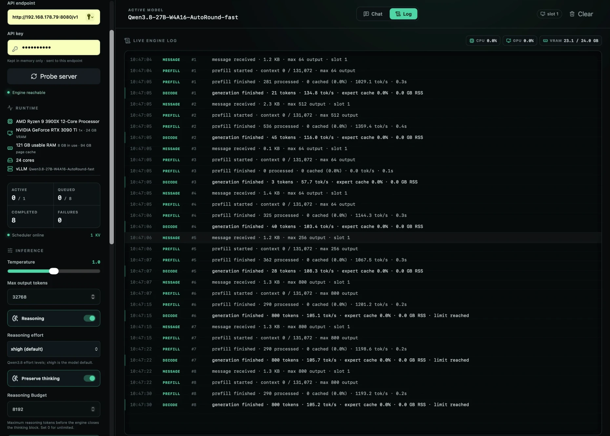

# AI-DER 1.5.1

**Artificial Intelligence Distributed Engram Runner** is a local inference runner
for Qwen3.8-Flash-Next quantized mixture-of-experts models. It combines SSD-backed
weights, RAM caching and CUDA GPU tiers, with expert-prefetch experiments,
an OpenAI-compatible API and a browser dashboard with chat.

AI-DER is based on [colibrì](https://github.com/JustVugg/colibri), with a custom
Qwen3.8 engine, container converter, GPU routing and inference kernels.



## System requirements

- PC running **Ubuntu 24.04 or 26.04 LTS, x86_64**, with a CUDA-compatible NVIDIA driver.
- **128 GB RAM**, DDR4 or newer.
- **NVIDIA RTX 3090 or RTX 3090 Ti**, 24 GB VRAM.
- **PCIe 4.x or newer NVMe SSD as the system drive**, with about **410 GB free** for
  the full installation (weights 95 GB, engine container 61 GB, MTP draft 8 GB,
  vLLM stack and weights 40 GB, llama.cpp 3 GB, CUDA 13 toolkit 4 GB, Strata and its
  two IQ3_S models 180 GB). Keep the data directory on NVMe.
- **CUDA Toolkit 12.4 or newer**, including `nvcc`, CUDA runtime and cuBLAS.
- Internet access and sudo rights for installation. Model weights are downloaded
  from Hugging Face under their own licenses.

`./install.sh --check` verifies the OS, usable RAM, GPU model, toolkit version and
free disk space. Confirm the SSD interface generation and the installed RAM type
from your hardware specifications.

## Install

Install a compatible NVIDIA driver and CUDA toolkit following the
[NVIDIA Linux installation guide](https://docs.nvidia.com/cuda/archive/12.4.1/cuda-installation-guide-linux/index.html).
Reboot after driver installation and confirm `nvidia-smi` works. If the toolkit
is not at `/usr/local/cuda`, `/usr/lib/cuda`, or on PATH, set `CUDA_HOME` (for example `/usr/local/cuda-12.4`).

```bash
sudo apt-get update
sudo apt-get install -y git
git clone https://github.com/tbro0815/ai-der.git
cd ai-der
git checkout v1.5.1
./install.sh --check
./install.sh
```

Run the installer as your normal user. The default installation does everything:

1. **Engine and dashboard.** GCC/G++ 13, CMake, Make, Python 3.12 or newer,
   venv/development headers, curl, patch and xz via apt; a `.venv` with AI-DER in
   editable mode plus NumPy, Pillow, gguf, the Hugging Face CLI and uv; Node.js
   >=22.12 (system or a checksum-verified Node 22 LTS in `.venv/node`); the locked
   dashboard build; the Qwen3.8 CUDA engine for Ampere `sm_86`.
2. **Weights and container** (`engine/c/install_models.sh`): the Qwen3.8-Flash-Next
   UD-IQ4_XS GGUF shards and vision projector (Unsloth), the tokenizer and chat
   template (Qwen), the MTP draft tensors fetched by HTTP range requests, then the
   engine container conversion and the MTP container (BF16 to Q8_0). Tens of
   minutes after the download; every step resumes on rerun.
3. **CUDA 13 toolkit** (`engine/c/install_cuda13.sh`): NVIDIA's pip wheels assembled
   into `~/ai-der-data/cuda13` for the llama.cpp, Strata and Maya builds; the system toolkit
   is left alone. On glibc 2.41+ (Ubuntu 26.04) the view carries a private copy of
   `crt/math_functions.h` whose `rsqrt`/`rsqrtf` declarations match glibc's.
4. **llama.cpp backend** (`engine/c/install_llamacpp.sh`): `llama-server` built with
   CUDA at a pinned revision that carries the MoE expert cache (`-cmoe
   --moe-cache-mib 12000`: every expert in RAM, the hot ones in VRAM).
5. **vLLM backend** (`engine/c/install_vllm.sh`): the syv-ai HyperQwen stack (Qwen3.8-27B
   on vLLM 0.31.0) at a pinned revision in its own Python 3.12 venv, the published W4A16 weights, the
   one-time CPU preparation (int8 heads, int8 MTP draft, draft vocabulary, fast
   variant) and the stack's vLLM patches.
6. **Strata backend** (`engine/c/install_strata.sh`): [Strata](https://github.com/Niko1221/Strata),
   an inference engine for Qwen3.8-Flash-Next, built from source at a pinned revision,
   with three models: ISTA-DASLab's GSQ-RCO IQ3_S pack, DavidAU's abliterated
   (uncensored) GSQ-RCO IQ3_S and the UD-IQ4_XS GGUF from step 2. `AI_DER_STRATA_MODELS=gsq,uncensored,ud`
   picks a subset.
7. **Maya backend** (`engine/c/install_maya.sh`, only with `--with-maya`):
   [Project Maya](https://github.com/mw00/project-maya), Strata's fork for
   GLM-5.3-Flash and DeepSeek-V4.1-Flash, built from source at a pinned revision, with
   its own setup per model (download with sha256 checks, pack, vision encoder):
   GLM-5.3-Flash Maya-S24 and Maya-M-Derisked, DeepSeek-V4.1-Flash Maya-S (about
   560 GB together). `AI_DER_MAYA_MODELS=glm-s24,glm-m-derisked,ds4-s` picks a subset.
8. **`ai-der.env`** in the checkout: the serving environment for all installed
   backends. `--systemd` also writes `~/.config/systemd/user/ai-der.service`.

Everything lands under `~/ai-der-data` (`--data-dir DIR` changes it). Flags:
`--core-only` installs the engine and dashboard only, `--skip-models`,
`--skip-llamacpp`, `--skip-vllm` and `--skip-strata` drop one component, `--with-maya` adds
the Maya backend, `--no-apt` skips the sudo
step on a provisioned host. Keep the checkout in place: the editable command runs
its engine sources here. The full download-and-convert path is long (an hour or
more, dominated by the 95 GB download and the conversion) and was assembled from
the steps used on the reference machine; it has not yet been rerun end to end on a
fresh host for this release, so a failing step is rerunnable and reports its name.

## Run

```bash
set -a; source ai-der.env; set +a
.venv/bin/ai-der serve --model ~/ai-der-data/models/qwen38-container \
  --host 127.0.0.1 --port 8080 --ngen 32768
```

Open `http://127.0.0.1:8080` in a browser for the dashboard; the API base URL is
`http://127.0.0.1:8080/v1`. The default backend is AI-DER. The Extra section of the
dashboard selects, for the next restart, the context profile first: `standard`
(131K, every engine), `fast` (80K, vLLM only), `vllm-190k` (190K, vLLM only) or
`long` (262K, llama.cpp, Strata or Maya). The engine list then offers the engines that
serve that profile, and the model list the models of the chosen engine (vLLM's
27B models, Strata's three, Maya's GLM-5.3-Flash and DeepSeek-V4.1-Flash models).
With `--systemd`: `systemctl --user enable --now ai-der.service`.

**Web search in the chat.** Enter a [Serper](https://serper.dev) API key in the
sidebar's Web Search section and switch the tool on: the dashboard then declares
one function tool, `web_search`, on every request of the chat, so the model can
search from the first turn. The key stays in the browser's local storage and
travels with each search to `/v1/tools/web_search`, where the gateway relays the
query to Serper and returns titles, links and snippets as a tool message; the
server never stores the key. Works on every backend, since tool calls are parsed
by the gateway.

For LAN access set `COLI_API_KEY`, configure `COLI_ALLOWED_HOSTS` for your server
hostname/IP (both have commented placeholders in `ai-der.env`), and bind to
`0.0.0.0`. Keep credentials outside the repository.

### Manual model preparation (`--core-only`)

Obtain all shards of a compatible **Qwen3.8-Flash-Next UD-IQ4_XS GGUF** and the
matching Hugging Face `tokenizer.json`, then convert the first shard (the converter
finds its siblings):

```bash
.venv/bin/python engine/c/convert_qwen38.py \
  --gguf /path/to/model-00001-of-00003.gguf \
  --tokenizer /path/to/tokenizer.json \
  --out /path/to/qwen38-container
```

MTP needs the draft module: `engine/c/fetch_mtp_tensors.py` fetches it from the
Qwen repository and `engine/c/convert_mtp.py` writes `<container>/mtp`.

## Versions and development

`engine/c/version.py` is the single application version source, shared by
Python package metadata and `ai-der --version` (`coli` remains an alias).
Use semantic versioning: MAJOR for incompatible changes, MINOR for compatible
features, PATCH for fixes. Releases are tagged `vMAJOR.MINOR.PATCH`; this release
is **v1.5.1**. Internal upstream component metadata is independent.

```bash
.venv/bin/ai-der --version
.venv/bin/python engine/c/convert_qwen38.py --self-test
python3 engine/c/tests/test_release.py
```

## Credits and license

The engine is a modified Apache-2.0 colibrì fork; see [LICENSE](engine/LICENSE),
[upstream provenance](engine/UPSTREAM.txt) and [third-party notices](engine/THIRD_PARTY_NOTICES.md).
GGUF and quantization formats build on llama.cpp/ggml (MIT). Model architecture
and weights are from the Qwen team; UD-IQ4_XS quantization is by Unsloth.
Original copyright and license notices are retained. Model licenses are separate.
